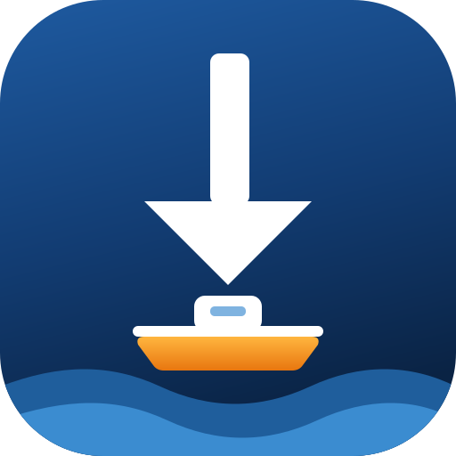

   

<h1 align="center">FerryLink</h1>

<b>免费开源 · 六大网盘 · 多种下载协议 · 多种热门下载器</b>

   
   
    
   
   
    
   
   
   

---

**👉 一个免费开源的网盘下载助手 👈**

【FerryLink】是一款免费开源 **获取网盘文件真实下载地址** 的油猴脚本，支持 Windows、Mac、Linux 多平台，兼容 IDM、XDown、Aria2、NDM、Motrix、终端等下载器，支持 HTTP、JSON-RPC、cURL 多种下载协议。

> ⚠️ **建议配合网盘超级会员使用** — 本助手仅解析下载链接，不突破网盘限速

---

## 💡 功能特性

| 特性 | 说明 |
|------|------|
| 🎯 **六大网盘支持** | 百度网盘、阿里云盘、天翼云盘、迅雷云盘、夸克网盘、中国移动云盘 |
| ⚡ **多种下载协议** | HTTP 直链下载、Aria2 下载、JSON-RPC 远程下载、cURL 命令下载 |
| 🔧 **兼容主流下载器** | IDM、XDown、Aria2、NDM、Motrix、浏览器自带下载 |
| 🔒 **配置内嵌本地** | 所有配置已内嵌脚本，不依赖第三方远程服务器 |
| 🎨 **自定义主题** | 支持更换主题颜色，7种预设可选 |
| 📦 **批量下载** | 支持一次性获取多个文件下载链接 |

---

## 📋 支持平台

| 网盘 | 访问地址 |
|------|----------|
| 百度网盘 | `pan.baidu.com` / `yun.baidu.com` |
| 阿里云盘 | `aliyundrive.com` / `alipan.com` |
| 天翼云盘 | `cloud.189.cn` |
| 迅雷云盘 | `pan.xunlei.com` |
| 夸克网盘 | `pan.quark.cn` |
| 移动云盘 | `yun.139.com` / `caiyun.139.com` |

---

## 📥 安装方法

### 1. 安装 Tampermonkey（油猴）

| 浏览器 | 安装地址 |
|--------|----------|
| Chrome | [Chrome 网上应用店](https://chromewebstore.google.com/detail/tampermonkey/dhdgffkkebhmkfjojejmpbldmpobfkfo) |
| Edge | [Microsoft Edge 扩展商店](https://microsoftedge.microsoft.com/addons/detail/tampermonkey/iikmkjmpaadaobahmlepeloendndfphd) |
| Firefox | [Firefox 附加组件](https://addons.mozilla.org/firefox/addon/tampermonkey/) |

### 2. 安装脚本

**方法一：直接安装（推荐）**

1. 打开 [网盘直链下载助手.user.js](https://raw.githubusercontent.com/Wjavan/FerryLink/main/网盘直链下载助手.user.js)
2. Tampermonkey 会提示安装，点击 **安装** 即可

**方法二：从 GreasyFork 安装**

访问 [GreasyFork 页面](https://greasyfork.org/zh-CN/scripts/595544-%E7%BD%91%E7%9B%98%E7%9B%B4%E9%93%BE%E4%B8%8B%E8%BD%BD%E5%8A%A9%E6%89%8B) 点击 **安装**

---

## 📖 使用说明

1. **登录网盘** — 打开对应网盘的网页版并登录账号
2. **勾选文件** — 在网盘页面勾选要下载的文件
3. **点击按钮** — 点击页面上出现的 **"下载助手"** 按钮
4. **选择模式** — 选择下载模式（API / Aria2 / RPC / cURL / BC）

### 各网盘下载器适配

| 下载器 | 推荐协议 | 说明 |
|--------|----------|------|
| IDM | API | 自动唤起 IDM 下载 |
| XDown | API | 自动唤起 XDown 下载 |
| Aria2 | RPC/Aria | 支持 JSON-RPC 或复制 aria2c 命令 |
| Motrix | RPC | 支持 JSON-RPC 远程添加任务 |
| 浏览器 | API | 直接浏览器下载 |
| 终端 | cURL | 复制 curl 命令到终端执行 |

---

## ⚙️ 配置说明

脚本内置配置项（油猴菜单 → 设置）：

| 配置项 | 默认值 | 说明 |
|--------|--------|------|
| RPC主机 | `http://localhost` | Aria2/Motrix RPC 地址 |
| RPC端口 | `16800` | Motrix 默认端口 |
| RPC路径 | `/jsonrpc` | JSON-RPC 路径 |
| RPC密钥 | (空) | Aria2 认证密钥 |
| 保存路径 | `C:` | 下载文件保存目录 |
| 终端类型 | Windows CMD | 可选：CMD/PowerShell/Linux/MacOS |
| 主题颜色 | #09AAFF | 7种预设颜色可选 |

---

## 📝 注意事项

- ⏰ 各网盘下载直链均**有时效性**，过期后请重新获取
- 🐢 部分网盘对直链下载**有限速**，属官方限制，脚本无法突破
- 🔒 脚本**仅解析下载链接**，不存储、不转发任何用户数据
- 📂 建议配合 IDM 等多线程下载器获得更好速度

---

## 🔗 相关链接

| 链接 | 地址 |
|------|------|
| 📦 GreasyFork 安装页 | [greasyfork.org/zh-CN/scripts/595544](https://greasyfork.org/zh-CN/scripts/595544) |
| 🌐 项目主页 | [github.com/Wjavan/FerryLink](https://github.com/Wjavan/FerryLink) |
| 🐛 提交 Issue | [github.com/Wjavan/FerryLink/issues](https://github.com/Wjavan/FerryLink/issues) |
| 🍴 查看 Forks | [github.com/Wjavan/FerryLink/forks](https://github.com/Wjavan/FerryLink/forks) |

---

## 🙏 致谢

本脚本基于 [油小猴](https://www.youxiaohou.com/) 的「网盘直链下载助手」二次修改，在原版基础上进行了功能增强与优化，并将配置内嵌脚本。感谢原作者的优秀作品。

---

## 📄 许可

本脚本基于 **GPL-3.0** 许可发布，详见 [LICENSE](LICENSE)。

---

## 🌟 Star History

---

**如果这个项目对你有帮助，欢迎 Star ⭐ 支持！**
